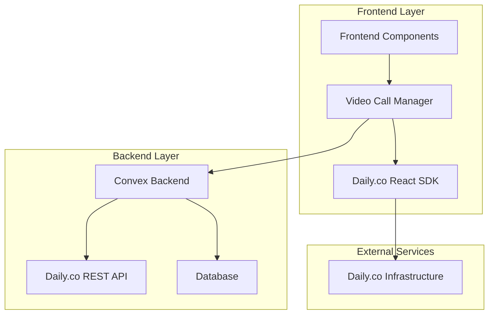
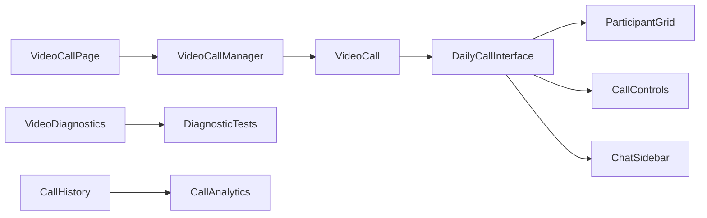
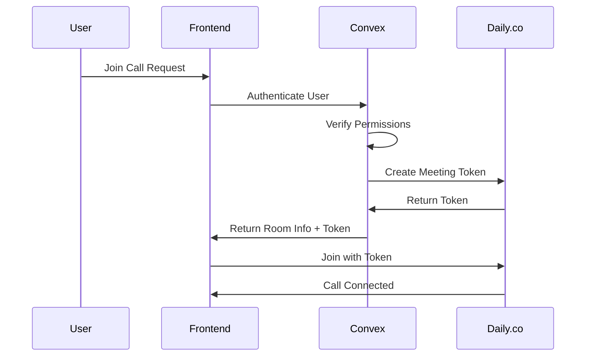

# Video Call Daily.co Integration Design Document

## Overview

This design document outlines the architecture and implementation approach for integrating Daily.co video calling functionality into the Rehabify Health platform. The solution will provide a robust, scalable video communication system that handles the specific needs of healthcare consultations while maintaining security and compliance standards.

## Architecture

### High-Level Architecture



### Component Architecture



## Components and Interfaces

### 1. Core Components

#### VideoCallManager

- **Purpose**: Orchestrates video call lifecycle and state management
- **Responsibilities**:
  - Call creation and scheduling
  - Participant management
  - Call history tracking
  - Error handling and recovery

#### VideoCall

- **Purpose**: Main video call interface wrapper
- **Responsibilities**:
  - Daily.co SDK initialization
  - Room connection management
  - Authentication and authorization
  - Resource cleanup

#### DailyCallInterface

- **Purpose**: Interactive video call UI
- **Responsibilities**:
  - Participant video grid
  - Call controls (mute, video, screen share)
  - Chat functionality
  - Connection status display

### 2. Service Layer

#### DailyService

- **Purpose**: Abstraction layer for Daily.co API interactions
- **Methods**:
  ```typescript
  class DailyService {
    createRoom(config: DailyRoomConfig): Promise<DailyRoom>;
    getRoom(roomName: string): Promise<DailyRoom>;
    deleteRoom(roomName: string): Promise<void>;
    createMeetingToken(
      roomName: string,
      properties: TokenProperties,
    ): Promise<string>;
    getRoomAnalytics(roomName: string): Promise<RoomAnalytics>;
  }
  ```

#### VideoCallService (Convex)

- **Purpose**: Backend business logic for video calls
- **Functions**:

  ```typescript
  // Actions
  createVideoCall(input: CreateVideoCallInput): Promise<CreateVideoCallOutput>

  // Mutations
  joinVideoCall(roomId: string): Promise<JoinCallResult>
  startVideoCall(callId: Id<"videoCalls">): Promise<void>
  endVideoCall(callId: Id<"videoCalls">): Promise<void>
  cancelVideoCall(callId: Id<"videoCalls">, reason: string): Promise<void>

  // Queries
  getVideoCall(roomId: string): Promise<VideoCall | null>
  getUserCallHistory(limit?: number): Promise<VideoCall[]>
  getClinicVideoCalls(clinicId: Id<"clinics">): Promise<VideoCall[]>
  ```

## Data Models

### VideoCall Schema

```typescript
interface VideoCall {
  _id: Id<"videoCalls">;
  roomId: string;
  dailyRoomName?: string;
  dailyRoomUrl?: string;
  dailyRoomId?: string;

  // Metadata
  title?: string;
  appointmentId?: Id<"appointments">;
  initiatorId: Id<"users">;
  participants: Id<"users">[];

  // Healthcare specific
  patientId?: Id<"users">;
  physiotherapistId?: Id<"users">;
  clinicId?: Id<"clinics">;

  // Scheduling
  scheduledAt?: number;
  startTime: number;
  endTime?: number;
  duration?: number;

  // Status and type
  status: "scheduled" | "active" | "ended" | "cancelled" | "missed";
  callType: "appointment" | "consultation" | "emergency";
  platform: "daily" | "internal" | "google_meet" | "zoom";

  // Configuration
  settings: {
    recordingEnabled: boolean;
    chatEnabled: boolean;
    maxParticipants: number;
    waitingRoomEnabled: boolean;
    screenShareEnabled: boolean;
  };

  // Audit
  createdAt: number;
  cancelledBy?: Id<"users">;
  cancellationReason?: string;
  cancelledAt?: number;
}
```

### VideoCallParticipant Schema

```typescript
interface VideoCallParticipant {
  _id: Id<"videoCallParticipants">;
  callId: Id<"videoCalls">;
  userId: Id<"users">;

  // Participation tracking
  joinedAt: number;
  leftAt?: number;
  role: "host" | "participant" | "observer";

  // Daily.co integration
  dailyMeetingToken?: string;
  dailyTokenExpiration?: number;

  // Permissions
  permissions: {
    canSpeak: boolean;
    canVideo: boolean;
    canScreenShare: boolean;
    canChat: boolean;
    canRecord: boolean;
  };
}
```

## Error Handling

### Error Categories and Responses

#### 1. Connection Errors

```typescript
interface ConnectionError {
  type: "connection";
  code: "NETWORK_FAILURE" | "TIMEOUT" | "DAILY_UNAVAILABLE";
  message: string;
  recovery: {
    automatic: boolean;
    userAction?: string;
    retryable: boolean;
  };
}
```

#### 2. Permission Errors

```typescript
interface PermissionError {
  type: "permission";
  code: "CAMERA_DENIED" | "MICROPHONE_DENIED" | "UNAUTHORIZED";
  message: string;
  instructions: string[];
}
```

#### 3. API Errors

```typescript
interface APIError {
  type: "api";
  code: "ROOM_NOT_FOUND" | "TOKEN_EXPIRED" | "RATE_LIMITED";
  message: string;
  statusCode: number;
}
```

### Error Handling Strategy

1. **Graceful Degradation**: Audio-only mode when video fails
2. **Automatic Retry**: Network issues with exponential backoff
3. **User Guidance**: Clear instructions for permission issues
4. **Fallback Options**: Alternative meeting platforms when Daily.co fails

## Testing Strategy

### Unit Tests

- Component rendering and state management
- Service layer API interactions
- Error handling scenarios
- Permission management

### Integration Tests

- Daily.co SDK integration
- Convex backend functions
- End-to-end call flow
- Cross-browser compatibility

### E2E Tests

```typescript
describe("Video Call Flow", () => {
  test("Complete call lifecycle", async () => {
    // 1. Create call
    // 2. Join as multiple participants
    // 3. Test controls (mute, video, screen share)
    // 4. Send chat messages
    // 5. End call
    // 6. Verify call history
  });
});
```

### Performance Tests

- Call connection time (target: <3 seconds)
- Video quality adaptation
- Memory usage monitoring
- Network bandwidth optimization

## Security Implementation

### Authentication Flow



### Security Measures

1. **Token-based Authentication**: Short-lived meeting tokens
2. **Permission Verification**: Role-based access control
3. **Encrypted Communications**: End-to-end encryption via Daily.co
4. **Audit Logging**: All call activities logged
5. **Data Retention**: Automatic cleanup of expired tokens

## Mobile Optimization

### Responsive Design

- Adaptive video grid layout
- Touch-friendly controls
- Portrait/landscape orientation support
- Swipe gestures for chat and controls

### Performance Optimization

- Lazy loading of video components
- Automatic quality adjustment
- Background app handling
- Battery usage optimization

### Mobile-Specific Features

```typescript
interface MobileFeatures {
  touchControls: boolean;
  orientationLock: boolean;
  backgroundMode: "audio-only" | "disconnect";
  qualityPreset: "auto" | "low" | "medium" | "high";
}
```

## Monitoring and Analytics

### Key Metrics

- Call success rate (target: >95%)
- Average connection time (target: <3 seconds)
- Video quality scores
- User satisfaction ratings
- Error frequency and types

### Monitoring Dashboard

```typescript
interface CallMetrics {
  totalCalls: number;
  successfulCalls: number;
  averageConnectionTime: number;
  averageCallDuration: number;
  errorsByType: Record<string, number>;
  participantSatisfaction: number;
}
```

### Alerting System

- Real-time error rate monitoring
- Daily.co service status alerts
- Performance degradation warnings
- User experience issue notifications

## Deployment Strategy

### Environment Configuration

```typescript
interface VideoCallConfig {
  dailyApiKey: string;
  dailyDomain: string;
  maxConcurrentCalls: number;
  defaultCallDuration: number;
  enableRecording: boolean;
  enableWaitingRoom: boolean;
}
```

### Feature Flags

- Gradual rollout to user segments
- A/B testing for UI improvements
- Emergency disable capability
- Beta feature testing

### Rollback Plan

1. Immediate: Disable video call features
2. Fallback: Redirect to external meeting platforms
3. Recovery: Restore from last known good state
4. Communication: User notifications and status updates

## Future Enhancements

### Phase 2 Features

- Call recording and playback
- Virtual backgrounds
- Breakout rooms for group sessions
- AI-powered call summaries

### Phase 3 Features

- Integration with wearable devices
- Real-time health monitoring during calls
- Multi-language translation
- Advanced analytics and insights

### Scalability Considerations

- Horizontal scaling for high call volumes
- Geographic distribution for global users
- Load balancing for optimal performance
- Caching strategies for frequently accessed data
