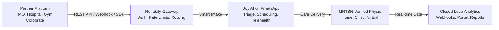

# Welcome to Rehabify Health API

Rehabify Health is the **physiotherapy and physical rehabilitation infrastructure layer** for Nigeria and West Africa. We provide standardized APIs, real-time webhooks, drop-in SDK widgets, and automated WhatsApp workflows that enable **HMOs, hospitals, telemedicine platforms, corporate employers, and fitness centers** to seamlessly connect patients with licensed physiotherapists.

---

## Integration Channels

Choose the integration channel that matches your technical requirements and timeline:

| Channel | Best For | Typical Setup Time | Authentication |
| :--- | :--- | :--- | :--- |
| **[REST API](/docs/api-reference)** | HMOs, EHRs, Telemedicine, Healthtech | 1–3 days | API Key (`Bearer sk_live_...`) |
| **[Webhooks](/docs/webhooks)** | Real-time session sync & closed-loop reports | 1–2 hours | HMAC SHA-256 Signature |
| **[Drop-in Embed Widget](/docs/sdks-widgets/embed-widget)** | Gym websites, corporate portals | 30 minutes | Public Key (`pk_live_...`) |
| **[WhatsApp Deep-Links](/docs/sdks-widgets/whatsapp-deep-links)** | Clinics, Doctors, SMS campaigns, QR codes | 15 minutes | Parameterized URL Tokens |
| **[Partner Portal](/partnerships)** | Non-technical clinic staff, HR admins | Instant | Email Magic Link / OAuth |

---

## Quick Navigation

<Cards>
  <Card title="Quickstart (5 Mins)" href="/docs/getting-started/quickstart">
    Send your first patient referral and test the Joy WhatsApp hand-off in 5 minutes.
  </Card>
  <Card title="API Reference" href="/docs/api-reference">
    Explore endpoints for referrals, eligibility verification, provider search, and clinical reports.
  </Card>
  <Card title="Webhooks & Events" href="/docs/webhooks">
    Listen to real-time events like `session.completed` and `treatment_plan.discharged`.
  </Card>
  <Card title="Partner Guides" href="/docs/guides">
    Tailored walkthroughs for HMO pre-auth, hospital referrals, gym recovery, and corporate wellness.
  </Card>
</Cards>

---

## Core Capabilities

### 1. 1-Click Patient Referrals
Send a single JSON payload with patient contact info and clinical notes. Rehabify automatically dispatches an intake link via WhatsApp, matches with an MRTBN-certified physiotherapist, and schedules the initial assessment.

### 2. Pre-Authorization & Coverage Checks
HMOs and corporate sponsors can instantly verify member eligibility and approve session allowances via `POST /v1/partners/eligibility`.

### 3. Closed-Loop Clinical Reporting
Every completed session generates detailed clinical notes, objective ROM (Range of Motion) metrics, and standardized functional recovery scores (PSFS, VAS, QuickDASH) delivered directly back to your system via Webhooks.

---

## Need Support?

* **Developer Community & Slack**: Join our partner engineering channel.
* **Email Support**: Reach out directly to [integrations@physioaroundme.com](mailto:integrations@physioaroundme.com).
* **Sandbox Environment**: Test all endpoints with mock test keys (`sk_test_...`) without incurring live session charges.
