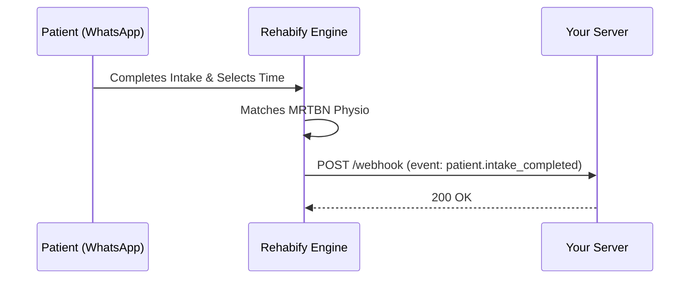

# Webhooks Overview

Webhooks allow Rehabify to notify your server in real time whenever an event occurs (such as a patient finishing their WhatsApp intake, a therapist confirming an appointment, or a patient completing a session).

---

## How Webhooks Work

1. You configure a webhook endpoint URL in your [Partner Portal](/partnerships) settings (e.g. `https://api.yourdomain.com/webhooks/rehabify`).
2. When an event occurs in Rehabify, we construct an event object and send an HTTP `POST` request with a JSON payload to your configured URL.
3. Your server validates the `X-Rehabify-Signature` header to ensure authenticity and responds with an HTTP `200 OK` status.

---

## Headers Included with Every Webhook

| Header | Description |
| :--- | :--- |
| `Content-Type` | `application/json` |
| `X-Rehabify-Event` | The type of event (e.g. `session.completed`) |
| `X-Rehabify-Delivery-Id` | Unique ID for this webhook delivery attempt |
| `X-Rehabify-Signature` | HMAC SHA-256 signature generated using your webhook secret |
| `X-Rehabify-Timestamp` | Unix timestamp of when the webhook was generated |

---

## Next Steps

* Explore the full [Event Catalog](/docs/webhooks/event-catalog) to see all available event payloads.
* Implement [Signature Verification](/docs/webhooks/signature-verification) to securely validate payloads.
* Learn about our [Retry Policy](/docs/webhooks/retry-policy) and delivery guarantees.
