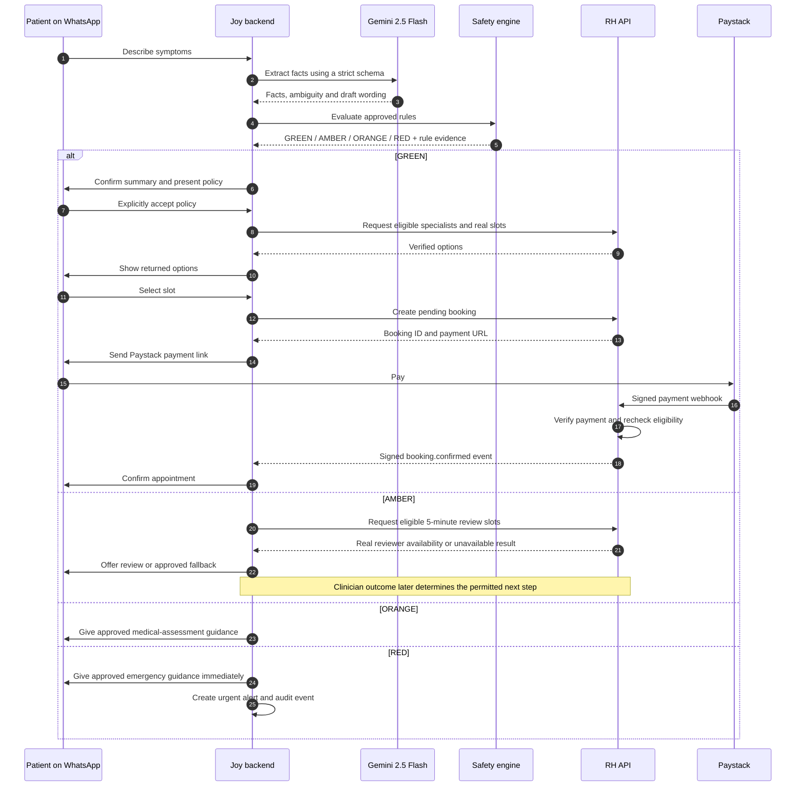
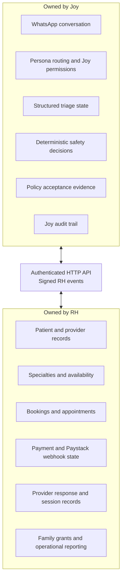

# Joy AI Under the Hood

This document shows how a WhatsApp message moves through Joy, what Gemini is allowed to do, what Joy's backend decides, and how Joy exchanges operational data with Rehabify Health (RH).

## System architecture

Phase 0 clarification: [the shared contract](JOY_RH_API_CONTRACT.md) separates payment
success from provider acceptance. Any abbreviated payment-to-confirmation arrow below includes
RH awaiting provider acceptance and rechecking current safety, consent and slot allocation.
Joy reports payment received while awaiting acceptance; only RH's final signed
`booking.confirmed` event permits an appointment-confirmed message.

```mermaid
flowchart LR
    U["WhatsApp user<br/>Patient · Physiotherapist · Family · Admin"]
    WA["Meta WhatsApp Business API"]

    subgraph RAILWAY["Joy platform on Railway"]
        API["Joy API<br/>Receives webhooks and returns quickly"]
        Q["Redis<br/>Queue and short-lived coordination"]
        W["Joy worker<br/>Processes conversation jobs and retries"]
        ID["Identity and permissions<br/>Phone → persona → allowed actions"]
        STATE["Conversation orchestrator<br/>Loads state and controls the stage"]
        EXTRACT["Structured extraction layer<br/>Story → typed clinical facts"]
        SAFETY["Deterministic safety engine<br/>Versioned general + region rules"]
        GATE{"Safety outcome"}
        GREEN["GREEN<br/>Routine pathway may continue"]
        AMBER["AMBER<br/>Offer 5-minute specialist review"]
        ORANGE["ORANGE<br/>Medical assessment guidance"]
        RED["RED<br/>Emergency guidance + urgent alert"]
        CONSENT["Policy and consent gate<br/>Explicit versioned acceptance"]
        RESP["Response composer<br/>Approved action + natural wording"]
        DB[("Joy PostgreSQL<br/>State · assessments · consent<br/>identity mappings · audit log")]
        EVENTS["RH event receiver<br/>Signature + replay validation"]

        API --> Q --> W --> ID --> STATE
        STATE --> EXTRACT --> SAFETY --> GATE
        GATE -->|"Clear"| GREEN --> CONSENT
        GATE -->|"Unclear / concerning"| AMBER
        GATE -->|"Medical review required"| ORANGE
        GATE -->|"Potential emergency"| RED
        GREEN --> RESP
        AMBER --> RESP
        ORANGE --> RESP
        RED --> RESP
        ID <--> DB
        STATE <--> DB
        SAFETY --> DB
        CONSENT --> DB
        EVENTS --> Q
    end

    subgraph GEMINI["Gemini AI"]
        LLM["Gemini 2.5 Flash<br/>Understands free text<br/>Extracts structured facts<br/>Detects / mirrors language<br/>Writes concise WhatsApp wording"]
        RAG["Approved RAG knowledge<br/>Glossary · service information<br/>patient education · specialties"]
        LLM <--> RAG
    end

    subgraph RH["Rehabify Health — RH Next.js project"]
        RHAPI["Versioned Joy API routes<br/>app/api/v1/joy/..."]
        RHAUTH["Service authentication<br/>authorization · idempotency"]
        DOMAIN["RH business logic<br/>Patients · physiotherapists<br/>matching · availability<br/>bookings · family access"]
        RHDB[("RH operational data<br/>Convex / RH data store")]
        PAY["Paystack integration<br/>Verifies webhook, amount and reference"]
        OUT["Signed domain events<br/>booking and review lifecycle"]

        RHAPI --> RHAUTH --> DOMAIN <--> RHDB
        PAY --> DOMAIN --> OUT
    end

    U -->|"Text · voice note · approved media"| WA
    WA -->|"Verified inbound webhook"| API
    STATE -->|"Prompt + permitted task + selected context"| LLM
    LLM -->|"Typed facts or draft wording<br/>never a final safety decision"| EXTRACT
    RESP -->|"Send message"| WA --> U

    CONSENT -->|"Authenticated API calls<br/>match · availability · booking · payment"| RHAPI
    AMBER -->|"Find and book eligible 5-minute reviewer"| RHAPI
    ID -->|"Resolve patient, PT number, or family grant"| RHAPI
    STATE -->|"Authorized physio / family operations"| RHAPI
    OUT -->|"Signed idempotent event"| EVENTS

    classDef user fill:#DCFCE7,stroke:#15803D,color:#111827;
    classDef joy fill:#DBEAFE,stroke:#2563EB,color:#111827;
    classDef ai fill:#F3E8FF,stroke:#7E22CE,color:#111827;
    classDef rules fill:#FEF3C7,stroke:#D97706,color:#111827;
    classDef rh fill:#E0F2FE,stroke:#0369A1,color:#111827;
    classDef danger fill:#FEE2E2,stroke:#DC2626,color:#111827;

    class U,WA user;
    class API,Q,W,ID,STATE,EXTRACT,CONSENT,RESP,DB,EVENTS joy;
    class LLM,RAG ai;
    class SAFETY,GATE,GREEN,AMBER,ORANGE rules;
    class RED danger;
    class RHAPI,RHAUTH,DOMAIN,RHDB,PAY,OUT rh;
```

## What Gemini does

Gemini is Joy's language and understanding layer. The backend sends it the current persona, conversation stage, known facts, permitted task, selected prompt fragments, and any approved RAG context needed for that turn.

Gemini may:

- Understand a patient's story from natural language or a voice transcript.
- Extract facts such as body region, onset, duration, symptoms, function and location into a strict schema.
- Classify a complex answer as `YES`, `NO` or `UNCLEAR` for a specific approved question, with supporting evidence.
- Detect and respond in English, Nigerian Pidgin, Yoruba, Igbo or Hausa.
- Turn an action already selected by the backend into a warm, concise WhatsApp message.
- Summarize permission-filtered RH data for an authorized family member or physiotherapist.

Gemini does not choose whether a case is safe, invent safety questions, grant permissions, confirm policy acceptance, select an unauthorized workflow, invent providers or appointment slots, or confirm that payment or booking succeeded.

## What Joy's backend does

Joy's backend is the decision and conversation-control layer. It:

1. Verifies the WhatsApp webhook and queues the message.
2. Resolves the sender's identity and permissions before other business logic.
3. Loads persistent context so Joy does not repeat known questions.
4. Controls the conversation stage and tells Gemini which limited task it may perform.
5. Validates and merges Gemini's structured extraction with source-message evidence.
6. Runs general and relevant body-region safety rules independently on every triage turn.
7. Applies outcome precedence: `RED > ORANGE > AMBER > GREEN`.
8. Enforces the appropriate action, consent and booking gates.
9. Calls RH through authenticated, versioned endpoints.
10. Records assessment revisions, consent, integration events and decisions in the append-only audit log.
11. Sends the resulting message through WhatsApp and retries recoverable delivery failures through the worker.

## How Joy and RH communicate

RH being a Next.js project does not prevent it from providing endpoints. Next.js route handlers under `app/api/v1/joy/...` can expose server-side HTTP APIs that call RH's internal business logic and data layer.

Joy uses RH for operational truth. Proposed endpoint groups include:

- Identity: resolve or provision a patient, resolve a physiotherapist by exact WhatsApp number, and resolve active family grants.
- Care marketplace: specialist matching, real availability, pending bookings, rescheduling and cancellation.
- Payment: initialize Paystack payment and read the authoritative payment or appointment status.
- Five-minute review: reviewer availability, review booking and an authorized clinician's recorded outcome.
- Physiotherapist operations: accept or reject assigned booking requests, update availability, add notes, record visit events and send patient messages.
- Family and admin operations: permission-filtered care summaries and explicit authorized operational queries.

RH checks authorization and ownership again for every request. Joy cannot write directly to RH's database or call browser-only Convex mutations. RH returns signed, idempotent events after committed changes, and Joy uses those events to update the WhatsApp conversation.

## Ownership boundary

The central rule is that Gemini helps Joy understand and communicate, Joy's backend determines safety and allowed actions, and RH owns the real-world operational records used to fulfil those actions.
