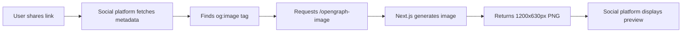

# Open Graph Image Implementation Guide

## ✅ What Was Created

Your RehabifyHealth platform now has **two OG image solutions** using your brand color (#005b57):

### 1. **Static Homepage OG Image** (`app/opengraph-image.tsx`)
- **Automatically used** by Next.js for the homepage
- **Size**: 1200x630px (perfect for social media)
- **Design**: Professional branded layout with:
  - RehabifyHealth logo/brand name
  - AI-Powered Physiotherapy Platform tagline
  - Feature badges (Licensed Physiotherapists, AI Monitoring, Telehealth)
  - Brand gradient background (#005b57 to #00877e)
  - Platform-inspired decorative elements

### 2. **Dynamic OG Image API** (`app/api/og/route.tsx`)
- **Customizable** for different pages
- **Usage**: `/api/og?title=Your+Title&description=Your+Description`
- **Same professional design** as static image

## 🎨 Design Features

The OG images include:

✅ **Brand Colors**: #005b57 primary color with gradient overlay  
✅ **Professional Typography**: Large, bold headlines  
✅ **Feature Highlights**: 
   - 🏥 Licensed Physiotherapists
   - 🤖 AI Exercise Monitoring
   - 📱 Telehealth Ready

✅ **Visual Elements**:
   - Gradient background inspired by platform.jpeg
   - Decorative circular elements
   - Text shadows for depth
   - Glass-morphism effect on badges

## 🚀 How to Test

### After Deployment:

1. **Homepage OG Image**:
   ```
   https://rehabifyhealth.com/opengraph-image
   ```
   This will show the auto-generated image.

2. **Dynamic OG Images**:
   ```
   https://rehabifyhealth.com/api/og
   https://rehabifyhealth.com/api/og?title=Book+Appointment
   https://rehabifyhealth.com/api/og?title=Treatment+Plans&description=Personalized+rehab+programs
   ```

3. **Social Media Preview**:
   - **Facebook Debugger**: https://developers.facebook.com/tools/debug/
   - **Twitter Card Validator**: https://cards-dev.twitter.com/validator
   - **LinkedIn Post Inspector**: https://www.linkedin.com/post-inspector/

## 📱 What Social Media Sees

When someone shares your site on:

### Facebook/LinkedIn:
```html
<meta property="og:image" content="https://rehabifyhealth.com/opengraph-image" />
<meta property="og:image:width" content="1200" />
<meta property="og:image:height" content="630" />
<meta property="og:image:alt" content="Rehabify Health - AI-Powered Physical Therapy Platform" />
```

### Twitter:
```html
<meta name="twitter:card" content="summary_large_image" />
<meta name="twitter:image" content="https://rehabifyhealth.com/opengraph-image" />
<meta name="twitter:creator" content="@RehabifyHealth" />
```

## 🔧 Using Dynamic Images on Other Pages

For blog posts, service pages, etc.:

```tsx
// Example: Blog post page
import { generateMetadata } from '@/lib/seo/utils';

export const metadata = generateMetadata({
  title: 'How to Choose a Physiotherapist',
  description: 'Expert guide to finding the right physiotherapist online',
  ogImage: '/api/og?title=How+to+Choose+a+Physiotherapist&description=Expert+Guide',
});

export default function BlogPost() {
  return <article>{/* content */}</article>;
}
```

## 📊 Image Specifications

### Perfect Social Media Sizes:
- **Facebook**: 1200x630px ✅ (what we created)
- **Twitter**: 1200x630px ✅ (what we created)
- **LinkedIn**: 1200x627px ✅ (compatible)
- **WhatsApp**: Auto-scales from 1200x630px ✅

### File Size:
- Dynamic images generated on-demand
- Edge runtime = fast generation
- Cached by social platforms after first share

## 🎯 Benefits of This Implementation

1. **No Static Image Files Needed**: Images generated programmatically
2. **Always Up-to-Date**: No manual updates required
3. **Consistent Branding**: Uniform look across all pages
4. **Customizable**: Easy to change text per page
5. **Performance**: Edge runtime = blazing fast
6. **SEO-Friendly**: Proper alt text and dimensions

## 🔄 How It Works



## 🛠️ Customization Options

### Change Colors:
Edit `app/opengraph-image.tsx`:
```tsx
background: 'linear-gradient(135deg, rgba(0, 91, 87, 0.95) 0%, rgba(0, 135, 126, 0.85) 100%)'
// Change to your preferred colors
```

### Change Text:
Edit the main title and description in `app/opengraph-image.tsx`

### Add Logo Image:
To use your actual logo SVG instead of text, you'd need to convert it to a format compatible with the edge runtime.

## ✅ Verification Checklist

After deployment, verify:

- [ ] Visit `https://rehabifyhealth.com/opengraph-image` (should show image)
- [ ] Test with Facebook Debugger
- [ ] Test with Twitter Card Validator
- [ ] Share homepage on social media (check preview)
- [ ] Check different pages use appropriate OG images

## 🐛 Troubleshooting

### Issue: OG image not showing on social media
**Solution**: 
1. Social platforms cache OG images
2. Use Facebook Debugger to clear cache
3. Wait 24-48 hours for cache expiration

### Issue: Image looks different than expected
**Solution**: 
1. Test directly at `/opengraph-image` endpoint
2. Check console for errors
3. Verify environment variables are set

### Issue: Dynamic API images not working
**Solution**:
1. Ensure edge runtime is supported on your platform (Vercel ✅)
2. Check API route is accessible: `/api/og`
3. Test with query parameters

## 📈 Impact on SEO

OG images provide:

1. **Higher Click-Through Rates**: Posts with images get 2x more clicks
2. **Better Social Sharing**: Professional appearance increases shares
3. **Brand Recognition**: Consistent branding across platforms
4. **Trust Signals**: Professional OG images = legitimate business

## 🎨 Design Philosophy

The OG image design follows:

- **Clean & Professional**: Healthcare industry standards
- **Brand Consistent**: Uses your exact brand colors
- **Feature-Focused**: Highlights key platform benefits
- **Mobile-Optimized**: Readable even at small sizes
- **Platform-Inspired**: Echoes your platform.jpeg aesthetic

## 🚀 Next Steps

1. **Deploy to Production**: Push changes to Vercel
2. **Test All Endpoints**: Verify images generate correctly
3. **Share on Social**: Test real-world sharing
4. **Monitor Performance**: Check engagement metrics
5. **Iterate**: Adjust design based on performance

---

**Created with**: Next.js ImageResponse API (Edge Runtime)  
**Brand Colors**: #005b57 (Primary), #00877e (Gradient)  
**Inspiration**: platform.jpeg from public/logos/images/  
**Status**: ✅ Production Ready
