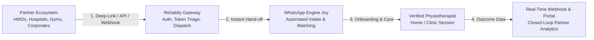

# Rehabify Health — Partnership Integrations & Ecosystem Strategy (PRD)

> **Core Strategic Shift**: Rehabify Health is moving towards a **WhatsApp-first engagement, intake, and booking ecosystem** (powered by Joy and the WhatsApp Business Platform). This provides zero-friction access for patients while giving enterprise partners seamless API, Webhook, and Deep-link connectivity.

---

## 1. Executive Summary & Vision

Traditional healthcare integrations fail in emerging markets because they demand heavy EHR customizations, dedicated mobile app downloads, and complex login portals. 

By leveraging **WhatsApp as the conversational UI layer** coupled with a **headless enterprise API & Webhook backend**, Rehabify enables partners to refer, sponsor, or integrate physiotherapy care in **less than 1 day of development time**, while maintaining 100% closed-loop reporting and clinical auditability.



---

## 2. Strategic Partnership Archetypes

| Partnership Type | Target Partners | Primary Use Case & Value Proposition | Integration Tier |
| :--- | :--- | :--- | :--- |
| **1. HMOs & Health Insurers** | Reliance HMO, AXA Mansard, Hygeia, Leadway, Bastion | **Pre-authorized Physio Network**: HMO members receive instant physio care without claims friction; HMO gets fixed-rate pricing and verified clinical reports. | **Tier 3 (Full API + Webhook)** |
| **2. Secondary Hospitals & Private Clinics** | General Hospitals, Orthopedic Clinics, Maternity Homes | **Outsourced Physio Department**: Clinics without in-house physiotherapists refer patients in 30 seconds; doctors receive discharge summaries and earn partner bonuses. | **Tier 1 & 2 (WhatsApp Deep-Link / Portal)** |
| **3. Corporate Wellness & Employers** | Banks, Tech Companies, Telecoms, Oil & Gas | **Ergonomics & Desk Worker Rehab**: Subsidized employee care packages (repetitive strain, back pain, posture) with HR aggregate health dashboard. | **Tier 2 (Corporate WhatsApp Portal)** |
| **4. Gyms, Sports Clubs & Fitness Centers** | Fitness Central, iFitness, Football Academies | **Injury Prevention & Recovery**: On-demand sports rehab for gym members recovering from sprains, tears, and joint strains. | **Tier 1 (QR Codes & Deep-links)** |
| **5. Health Financing & BNPL** | MediLoan (MyItura), Payhippo, Carbon | **Treatment Financing**: Pre-approved medical loans embedded into the patient booking and session payment flow. | **Tier 2 (Bidirectional Webhooks)** |
| **6. Telemedicine & E-Pharmacy Platforms** | Helium Health, Remedial Health, Wellahealth | **Cross-Specialty Referral Integration**: Telemedicine doctors route musculoskeletal cases directly to Rehabify. | **Tier 3 (REST API + Embedded Webview)** |

---

## 3. Integration Patterns: How Partners Connect

Rehabify provides **three flexible integration layers** ranging from zero-code deep linking to full enterprise API pipelines.

```
┌────────────────────────────────────────────────────────────────────────────┐
│                        REHABIFY INTEGRATION SPECTRUM                       │
├───────────────────────┬────────────────────────────┬───────────────────────┤
│ Tier 1: Zero-Code     │ Tier 2: Low-Code           │ Tier 3: Enterprise    │
│ WhatsApp Deep-Links   │ Embedded Widgets & Portals │ Headless REST API     │
├───────────────────────┼────────────────────────────┼───────────────────────┤
│ • Unique Partner URLs │ • 1-Click Referral Portal  │ • /v1/referrals       │
│ • Dynamic QR Codes    │ • Custom Form Embed        │ • /v1/eligibility     │
│ • UTM / Token Triage  │ • Instant SMS Triggers     │ • Real-time Webhooks  │
│ ⏱️ Setup: 15 Minutes  │ ⏱️ Setup: 2 Hours          │ ⏱️ Setup: 1-2 Days    │
└───────────────────────┴────────────────────────────┴───────────────────────┘
```

### Pattern A: Parameterized WhatsApp Deep-Linking (Zero-Code)
Partners embed a customized smart WhatsApp link in their app, email, SMS, or physical clinic flyer.

* **Format**:
  ```http
  https://wa.me/2348061525811?text=REHAB_REF_{PARTNER_CODE}_{PATIENT_ID}_{CASE_TYPE}
  ```
* **User Flow**:
  1. Patient clicks the link or scans a clinic QR code.
  2. WhatsApp opens automatically with a signed verification token.
  3. Joy immediately recognizes the partner (e.g. *Reliance HMO* or *Dr. Johnson's Clinic*), welcomes the patient by name, and skips generic onboarding.

### Pattern B: Partner Referral Webview / Micro-Portal (Low-Code)
A fast, authenticated 1-page form hosted at `partner.rehabifyhealth.com` or embedded in the partner's EHR.
* Doctor inputs: Patient Name, Phone Number, Diagnosis.
* Rehabify system automatically:
  1. Dispatches an outbound WhatsApp welcome template to the patient.
  2. Generates an encrypted referral tracking ID.
  3. Returns a confirmation receipt to the doctor.

### Pattern C: Headless Enterprise API & Webhooks (Full API)
For healthtech platforms, HMO management systems, and large hospital networks.

#### 1. Create Patient Referral (`POST /api/v1/partners/referrals`)
```json
{
  "partner_id": "hmo_reliance_091",
  "patient": {
    "first_name": "Tunde",
    "last_name": "Adeleke",
    "phone": "+2348031234567",
    "hmo_policy_number": "REL-99281-B",
    "location": {
      "city": "Lagos",
      "area": "Ikeja"
    }
  },
  "clinical_notes": {
    "diagnosis": "L4-L5 Lumbar Disc Herniation",
    "recommended_sessions": 6,
    "priority": "high",
    "referring_doctor": "Dr. Sarah Johnson (General Hospital)"
  },
  "billing_mode": "hmo_direct_billing",
  "callback_url": "https://api.partner.com/rehabify-webhook"
}
```

#### 2. Event Webhooks (Closed-Loop Feedback)
Rehabify streams event updates back to the partner in real time:

* `patient.whatsapp_intake_completed`
* `provider.matched` (*Dr. Chidera N. matched, MRTBN #4921*)
* `session.scheduled`
* `session.completed` (*Includes therapist progress note & pain score*)
* `treatment_plan.discharged` (*Includes PDF discharge summary*)

---

## 4. Documentation Strategy & Tooling

To ensure integrations are effortless for third-party developers, Rehabify should adopt standard developer documentation architecture.

### Recommended Tooling Stack:

1. **Documentation Platform: [Mintlify](https://mintlify.com/) or [Fern](https://buildwithfern.com/)**
   * *Why*: Modern interactive docs (used by Paystack, Anthropic, ElevenLabs), beautiful dark/light themes, built-in API playground where developers can test calls without leaving the browser, and Git-synced markdown.
   * *Alternative*: Self-hosted Nextra / MDX inside `app/docs` (if keeping everything in-repo).

2. **API Specification: OpenAPI 3.1 (Swagger)**
   * Single source of truth in `docs/openapi.yaml`.
   * Automatically generates TypeScript SDKs and Postman collections for partner engineering teams.

3. **Partner Sandbox Environment**:
   * Staging mock endpoints (`https://sandbox.rehabifyhealth.com`) that simulate WhatsApp webhook triggers without sending real SMS/WhatsApp messages.

---

## 5. Security, Compliance & Data Governance

* **Data Encryption**: End-to-end TLS 1.3 in transit; AES-256 for clinical records at rest.
* **NDPR (Nigeria Data Protection Regulation) Compliance**: Explicit patient consent collected at WhatsApp intake before medical notes are synced.
* **Partner Scoping**: API keys scoped strictly to partner tenants (`read:reports`, `write:referrals`).
* **Signature Verification**: Every webhook delivery includes an `X-Rehabify-Signature` SHA-256 HMAC header.

---

## 6. Implementation Roadmap

```
Phase 1: Foundation (Weeks 1-2)
├── WhatsApp intake token parser (Joy webhook handler)
├── Partner Referral API endpoint (/v1/partners/referrals)
└── Webhook dispatcher engine

Phase 2: Partner Self-Serve & Sandbox (Weeks 3-4)
├── Launch Developer Docs on Mintlify/OpenAPI
├── Doctor & Hospital 1-Click Web Referral Interface
└── Interactive Sandbox testing environment

Phase 3: HMO & Corporate Rollout (Weeks 5-6)
├── HMO Pre-Auth & Closed-loop discharge summary sync
├── Corporate Health package distribution via WhatsApp
└── Analytics Dashboard for Enterprise Accounts
```
